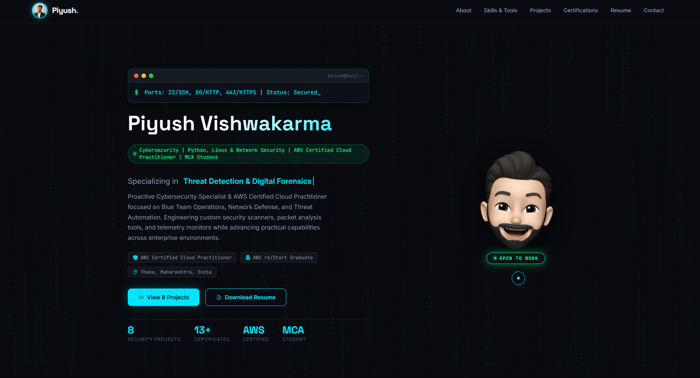

# 🛡️ Piyush Vishwakarma – Cybersecurity Portfolio

Welcome to my **Cybersecurity Portfolio**, a modern showcase of my projects, certifications, and technical expertise in ethical hacking, network defense, and digital forensics.  
I'm a **Cybersecurity Analyst (SOC | Digital Forensics | Incident Response | VAPT)**, an **AWS Certified Cloud Practitioner** and an **empanelled Security Researcher with the National Security Database**, with hands-on casework from a Digital Forensics internship.

📄 **Resume:** [Piyush Resume (PDF)](assets/Piyush_Resume.pdf)

---

## 🚀 Overview
This portfolio is built using **HTML**, **CSS**, and **JavaScript**, designed for clarity, responsiveness, and professional presentation.  
It highlights my practical skills in:
- **Digital Forensics:** disk, Windows, mobile (iOS & Android) and network forensics
- **SOC & Incident Response:** log/traffic analysis, IOC & phishing analysis, MITRE ATT&CK
- **VAPT & AppSec:** OWASP Top 10, XXE, SSRF, CVE analysis
- **Cloud Security (AWS Certified Cloud Practitioner)**
- **Python & Linux‑based Security Tools**

---

## 💼 Experience
**Digital Forensics Intern, AiTechnoverse Infotech Pvt. Ltd.** (Sep 2026 – Dec 2026)
- Evidence acquisition and analysis across multiple confidential investigations
- Mobile forensics on iOS & Android with Cellebrite UFED and Cellebrite Reader
- Disk, Windows and network forensics with Autopsy, FTK and Magnet Forensics tools
- Court-style forensic reporting with a reproducible methodology

---

### 🖼️ Portfolio Preview

---

## 🧰 Tools & Technologies
- **Forensics:** Cellebrite UFED, Cellebrite Reader, Autopsy, FTK, Magnet Forensics
- **Security:** Wireshark, Burp Suite, Nmap, Metasploit, Scapy, Kali Linux
- **Cloud & Code:** AWS (IAM, EC2, S3, VPC, CloudWatch), Python, Bash, SQL, Flask, Docker, Git

---

## 🛠️ Projects
- **SentinelX:** AI cyber deception & breach-and-attack simulation platform *(in development)*
- [Network Vulnerability Scanner](https://github.com/ItsPiyushVishwakarma/Network-Vulnerability-Scanner)
- **XXE Vulnerability Lab:** exploit → fix → retest (Flask, lxml, Docker)
- [Malware Analysis Lab](https://github.com/ItsPiyushVishwakarma/Malware-Analysis): Flare-VM & REMnux practicals
- [Python Log Analyzer](https://github.com/ItsPiyushVishwakarma/Python-Log-Analyzer) · [File Integrity Checker](https://github.com/ItsPiyushVishwakarma/Python-File-Integrity-Checker) · [Packet Sniffer](https://github.com/ItsPiyushVishwakarma/Python-Network-Packet-Sniffer) · [Port Scanner](https://github.com/ItsPiyushVishwakarma/Python-Port-Scanner) · [Hash Cracker](https://github.com/ItsPiyushVishwakarma/Password-Hash-Cracker) · [Password Strength Checker](https://github.com/ItsPiyushVishwakarma/Password-Strength-Checker) · [Keylogger + Detection Guide](https://github.com/ItsPiyushVishwakarma/Keylogger-Email-Alert)

---

## 📂 Repository Structure
| File | Description |
|------|--------------|
| `index.html` | Page structure and contact links |
| `styles.css` | Dark cyber theme and responsive layout |
| `script.js` | Typewriter, project filters, scroll effects and other interactions |
| `assets/` | Images and the resume PDF |

---

## 🧠 Certifications
- **AWS Certified Cloud Practitioner** (Apr 2025)
- **Security Researcher (Empanelled), National Security Database** (Sep 2026)
- **Google Cybersecurity** (4 courses) & **IBM Cybersecurity** (3 courses), Coursera
- **Deloitte Cyber Job Simulation**, via Forage (Jun 2026)
- **TryHackMe Pre Security Learning Path** (Oct 2026)
- **AWS re/Start Graduate**

## 🎓 Education
- **MCA in Cybersecurity**, Chhatrapati Shivaji Maharaj University, Panvel (2025 – 2027, expected)
- **B.Sc. Information Technology**, Tilak College, University of Mumbai (2021 – 2024)

---

## 🌍 Location
📍 Thane, Maharashtra, India  
💼 Open to Work: SOC, Digital Forensics, Incident Response & VAPT roles · Open to Relocation

---

## 📈 Stats
- **11 Security Projects**
- **14 Certifications**
- **AWS Certified**
- **NSD Security Researcher**

---

## 📬 Contact
- **Portfolio Website:** [Visit Here](https://itspiyushvishwakarma.github.io)
- **LinkedIn:** [www.linkedin.com/in/itspiyushkarma-cybersecurity](https://www.linkedin.com/in/itspiyushkarma-cybersecurity/)
- **GitHub:** [github.com/ItsPiyushVishwakarma](https://github.com/ItsPiyushVishwakarma)
- **Email:** vpiyush780@gmail.com

---

### 🧩 License
This project is open‑source under the **MIT License**.  
Feel free to explore, fork, and contribute!

---

⭐ **If you find this portfolio inspiring, give it a star!**
